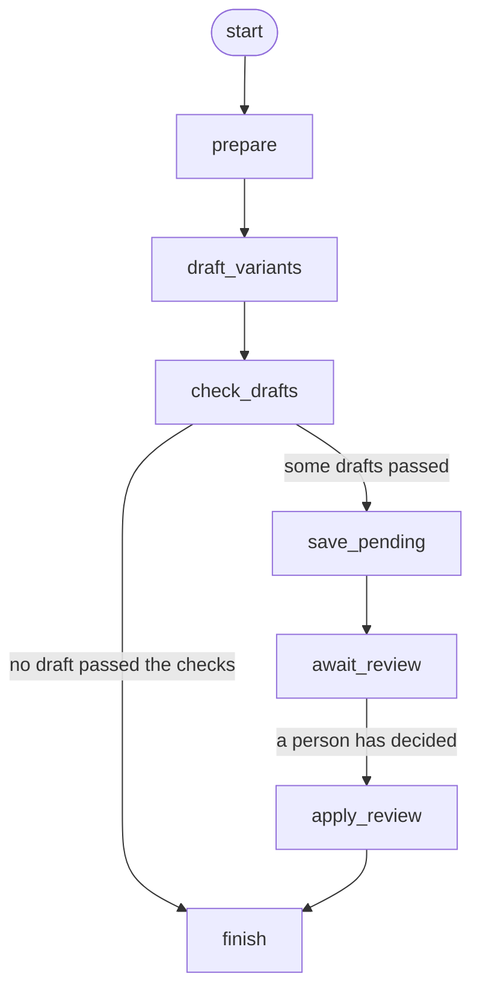

# Step 8e-1: LangGraph design for the decision pipeline

Status: the decision graph was built in 8e-2, behind `NUDGEIQ_ENGINE=graph` (default `classic`); its diagram is
`decision-graph.png`. The variant graph was built in 8e-3; its diagram is `variant-graph.mmd`. The trace, retries
and error handling were added in 8e-4 (last two sections: the variant graph first, then the decision graph).

## Scope

| Flow | In the graph? |
|---|---|
| `Orchestrator.decide()` | **Yes** (8e-2) |
| Variant generation: generate, check, wait for approval | **Yes**, as a second graph (8e-3) |
| `Orchestrator.record_outcome()` | No. It is mostly database updates and learning, with no choices to show. Revisit later if wanted |
| `MasterAgent` (the bandit) | Unchanged. The graph calls it; it is not rewritten |

## The graph

Each node wraps code that already exists. The order is the order in `decide()` today.

| Node | Wraps | Trace notes it must keep | Side effect |
|---|---|---|---|
| `load_state` | `StateAgent.build_state`, `_journey_for`, clock and retry-anchor update, `bucket_for`, new decision id | `orchestrator: journey is <status>: no nudge` (closed journeys) | Saves a new Journey if none exists |
| `entry_guardrail` | `GuardrailAgent.check_entry` | `guardrail: entry rule passed` or `suppressed at entry: ...` | none |
| `propose_actions` | `propose_channels/timings/offers/levers`, the product, the "no approved variant" drop | `channel`, `timing`, `offer` notes, `message: dropped N actions ...` | none |
| `guardrail_filter` | `GuardrailAgent.filter_actions` | `guardrail: blocked N of M ...`, `all actions blocked ...`, `no legal action left`, `N legal candidates` | none |
| `no_candidates` | the "no legal candidates" branch | `master: no legal candidates: waiting` | none |
| `master_select` | `MasterAgent.decide`, top-10 cut | `master: bucket=...; explored/exploited ...`, `holdout (control)...`, `scored N candidates; top 10 stored` | none (the Master's random choice only) |
| `compose_message` | `MessageAgent.render`, `send_time` | `message: used approved variant ...` or `could not build a message ...: waiting` | none |
| `dispatch` | `Dispatcher.send`, `record_contact`, `nudges_sent + 1` | `dispatch: <channel> send at ...` | **Sends, records contact, saves journey** |
| `finalize` | `_save` | none | **Saves the Decision** |

Every path ends in `finalize`, as in `decide()` today. The 14 edges are in `GRAPH_EDGES` in
`backend/app/graph/state.py`, and the picture is generated from them.

## Shared state

`DecisionGraphState` (a `TypedDict` in `state.py`). A node returns only the keys it changes.

- **Input:** `customer_id`, `now`.
- **`steps`** is the only accumulating key (`operator.add`). It becomes `Decision.steps`, so each
  node simply adds its own notes and the trace comes out in graph order.
- **Everything else is overwritten** by the node that owns it (`NODE_WRITES` lists who writes what).
- **Output:** `decision`, built once, in `finalize`, from the other keys.

Rules that keep it safe:
1. Only `dispatch` and `finalize` (and the first-time journey save in `load_state`) touch the database or
   send anything. Nodes before `dispatch` can be re-run freely.
2. No checkpointer on this graph. A checkpointer could replay a node after a crash and send twice.
3. Agent names in the trace (`guardrail`, `channel`, `timing`, `offer`, `message`, `master`,
   `orchestrator`, `dispatch`) must not change: the Live page and the customer audit view display them.

## Plan for 8e-2 (so nothing breaks)

1. Split `generate_candidates` into three small functions (entry check, propose, filter). The old
   `generate_candidates` calls them, so old and new paths share the same code.
2. Add `langgraph` to `requirements.txt` (pinned to the version that installs cleanly), build the
   graph from `GRAPH_EDGES`.
3. `NUDGEIQ_ENGINE=classic|graph`, default **classic**. `Orchestrator.decide()` delegates to the graph
   only when set to `graph`.
4. Equivalence test: same seed, same customers (simulator), run both engines on separate copies of the
   repository, and require identical `Decision` dumps, including the order and wording of `steps`,
   plus identical Master state afterwards. Cases: normal send, holdout, suppressed at entry, contact cap,
   outside hours, no approved variant, closed journey, retry round, epsilon-greedy variants.
5. Switch the default to `graph` only after that passes and you have clicked through the Live page.

## Findings from reading the code

- `generate_candidates` sets `suppressed` and `forced_wait`, but `decide()` ignores them and logs the
  same "no legal candidates" line either way. The graph can route on them without changing the trace.
- Holdout customers still get their candidates scored and stored; only the choice is forced to wait.
  This is kept as is.
- `_journey_for` writes to the database while building state (a first-time journey). That is why
  `load_state` is listed as having a side effect.
- Dispatch only logs today (no real sending), so replay risk is low now but matters once real senders
  or Celery arrive (8d).

## Decisions I am assuming (tell me if any is wrong)

1. Graph covers `decide` and variant generation only, not `record_outcome`.
2. Default stays `classic` until the equivalence test passes.
3. The Master bandit is not changed.

## 8e-3: variant generation as a graph, with a human approval pause

Code: `app/graph/variant_state.py` (shape, no langgraph needed), `variant_builder.py` (the graph),
`variant_runs.py` (start, read, resume), `app/api/variant_runs.py` (three endpoints). The picture is
`variant-graph.mmd` (Mermaid; GitHub shows it), generated from the edge list like the first one.

| Node | What it does | Side effect |
|---|---|---|
| `prepare` | Checks the request: count, campaign exists and is a draft, template exists | none |
| `draft_variants` | Asks the model, reads the reply as a list of drafts | **calls the model** |
| `check_drafts` | The guardrails: unknown `{{variable}}`, blank or long text, SMS without STOP, repeats. Also collects reviewer warnings | none |
| `save_pending` | Saves the drafts that passed, as PENDING | saves variants |
| `await_review` | **Stops** until a person sends decisions | none |
| `apply_review` | Approves or rejects what the person decided, through `CampaignService` | approves / rejects |
| `finish` | Closes the trace | none |

Same rules as `/variants/generate`: the node code calls the same `VariantGenerator` steps
(`prepare`, `request_drafts`, `screen`, `save`) that `generate()` now calls. A test runs both on
separate copies of the data and requires the same variants and the same skipped drafts.

Differences from the decision graph, and why:

1. **It has a checkpointer.** A pause needs one (langgraph keeps the paused run there). The rule
   "no checkpointer" for the decision graph was about sending twice. Here the risk is a node being
   replayed, so every node is safe to run twice (see the docstring in `variant_builder.py`), and
   the only node that calls the model is never replayed because a checkpoint is written after it.
2. **The state is plain JSON** (variants are dicts), the safest thing to put in a checkpoint.
3. **Nothing becomes approved without a person.** The graph never approves by itself; it can only
   reach `apply_review` when someone resumes it, and approving goes through
   `CampaignService.approve_variant`, so an LLM variant still cannot skip review.

Behaviour worth knowing:

- Runs live **in memory**. After a restart a run cannot be resumed, but nothing is lost: the new
  variants were saved as PENDING and the ordinary approve and reject endpoints still work.
- A review that names a variant not in the run, or names one twice, is refused with 422 and the run
  keeps waiting. A review that is valid but cannot be applied (the campaign was archived meanwhile,
  or someone approved the variant by hand) finishes the run and reports each failure per variant.
- An empty review (`"decisions": []`) ends the run and leaves everything pending.
- Variants the person does not mention stay PENDING.
- Two runs for the same template at the same moment can pick the same new variant id, exactly as
  two calls to the plain endpoint can. It is rare and not changed here.
- At most 200 runs are kept (the oldest finished ones are dropped first; a waiting run never is).

The plain endpoints (`/variants/generate`, `/approve`, `/reject`) are unchanged and always
available. The new endpoints are additive and do not depend on `NUDGEIQ_ENGINE`.

## 8e-4: trace, retries and clean failures (variant graph)

Code: `app/graph/trace.py` (no langgraph import), used by `variant_builder.py` and `variant_runs.py`.

**What is recorded.** `traced(name, fn, recorder, ...)` wraps a node. Each attempt writes one `TraceEntry`
(seq, node, attempt, status, started_at, duration_ms, wrote, notes, error) to a `TraceRecorder` keyed by
run id. Input and output values are not recorded: they can be large and can hold customer data.

**Why a recorder and not the graph state.** When a node raises, LangGraph drops that node's update, so the
state cannot carry the failure. The recorder sits beside the graph and sees every attempt, failed ones
included. The `steps` list in the state is unchanged and is still what the Live page shows.

**Statuses.** `ok`, `paused` (the `interrupt()` in `await_review`; LangGraph's pause signal is passed
through untouched), `retry` (failed, another attempt follows), `error` (failed for good).

**Retries.** Only `draft_variants` (the model call), only for `LLMError` and its subclass `LLMReplyError`,
2 attempts in total, waiting 0.5 s then 1.0 s... Set on `VariantRunService(llm_attempts=, retry_delay=)`.
Each retry is a new paid model call. No other node is retried: their errors are rule failures (the same
answer every time) or bugs. Every node was already safe to run twice (see `variant_builder.py`), so adding
retries did not change that.

**Failures.**

| Raised by a node | What the API does |
|---|---|
| `CampaignError`, `LLMError`, `ValueError`, `LookupError` (the expected ones) | Raised unchanged: 404 / 409 / 422 / 502 as before |
| anything else | `RunFailedError`: 500 with the node and error type in the message; traceback in the log |

A failed start leaves no run behind (and its trace is dropped with it; the log keeps the attempts). A
failure after the pause leaves the run at its last checkpoint: `status` is `error`, `error` names the node,
and the variants stay PENDING. There is no "resume after error" call yet; nodes are safe to replay, so one
could be added.

**Fixed on the way.** `POST .../review` on a finished run returned 422; it is now 409, as the 8e-3 test and
docs said. The cause: `RunStateError` is a `ValueError`, and the route's `except ValueError` caught it
before the app's 409 handler.

## 8e-4 (second half): trace for the decision graph

Same `traced()` wrapper and `TraceRecorder` as the variant graph, wired into `build_decision_graph(orch,
recorder)` and the orchestrator. Only the graph engine records; `classic` has no graph and records nothing.

**Where it goes.** To the recorder and the log, never into `Decision`. `Decision.steps` stays identical to
`classic` (the 8e-2 equivalence tests still run, now with tracing on). The two views agree: the notes in the
trace, joined in order, are exactly `Decision.steps`.

**Keys.** `decide()` makes a run id (`r_...`) for the graph. Log lines use it while the run goes. When the
graph returns, the entries are re-filed under the **decision id**, and one log line ties the two
(`run=r_ab12 is decision d_9f3c`). A separate run id is used because the decision id is made inside
`load_state`, and calling the id factory an extra time would change the ids the classic engine makes.

**Path.** A trace shows the route taken, for example `load_state, finalize` for a closed journey,
`load_state, entry_guardrail, no_candidates, finalize` for a suppressed customer, or all eight nodes
for a send. There is one attempt per node; the status is `ok` (there is no pause in this graph).

**No retries.** Unlike `draft_variants`, no node here is retried. `dispatch` sends, and running it twice
would send twice, which is also why this graph has no checkpointer.

**Failures.** The error is raised exactly as the classic engine raises it (`CustomerNotFoundError` is still
a 404, anything else the API's plain 500). The failed attempt is logged on `nudgeiq.graph` at WARNING with
the node and error type. The partial trace is dropped, because no Decision exists to attach it to; the log
line has it. (Nothing is saved when a run fails before `finalize`, as before.)

**Memory is bounded.** A decision never stops coming, unlike a variant run, so the recorder keeps the newest
2000 decisions (`TraceRecorder(max_runs=...)`) and drops the oldest. The runtime shares one recorder between
all campaigns' orchestrators, so a trace stays readable after the live campaign is swapped.

**Reading it.** `GET /decisions/{id}/trace` returns `{decision_id, engine, entries}`. `404` only if the
decision does not exist. `entries` is empty with the classic engine, after a restart, or once the decision
is among the oldest 2000. It is additive: `GET /decisions/{id}` and the Live page are unchanged.

**Not done.** No screen shows the trace yet (neither this one nor the variant run's); the endpoint is there
for one. The trace is not stored in the database, so it does not survive a restart.
